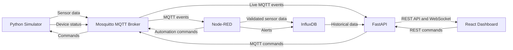

<div align="center">

# Smart Home Automation IoT Simulation

A full-stack IoT home automation system that simulates sensors, devices, automation rules, alerts, real-time data, and historical analytics without requiring physical hardware.


</div>

---

## Overview

This project simulates a smart-home IoT environment for one living room.

The system publishes sensor data through MQTT, applies automation rules with Node-RED, stores time-series data in InfluxDB, exposes REST and WebSocket APIs with FastAPI, and displays real-time data in a React dashboard.

No physical sensors, microcontrollers, or appliances are required.

## Features

- Simulated temperature, humidity, and presence sensors
- Simulated light and fan devices
- MQTT publish/subscribe communication
- Presence-based light automation
- Temperature-based fan automation
- Confirmed device-state feedback
- Device online/offline status using MQTT Last Will
- High-temperature and offline-device alerts
- Alert storage in InfluxDB
- Historical temperature and humidity charts
- FastAPI REST API
- FastAPI WebSocket real-time event stream
- React dashboard with live controls and alerts
- Optional Docker Compose deployment

## Architecture



## Component Responsibilities

| Component | Why it is used | Main responsibility |
|---|---|---|
| Python Simulator | Simulates real IoT devices without hardware | Publishes sensor data, receives device commands, confirms device states |
| Mosquitto | Lightweight MQTT broker | Routes publish/subscribe messages between services |
| Node-RED | Visual event-driven automation tool | Validates data, triggers automation rules, creates alerts, writes measurements to InfluxDB |
| InfluxDB | Time-series database | Stores sensor readings, device states, and alerts with timestamps |
| FastAPI | Fast Python backend framework | Provides REST endpoints, MQTT command publishing, and WebSocket events |
| React + Vite | Frontend framework and build tool | Displays sensor data, charts, alerts, and device controls |
| Recharts | React chart library | Displays historical temperature and humidity charts |
| Docker Compose | Optional deployment tool | Starts the system as reproducible containers |

## MQTT Topic Design

| Topic | Purpose |
|---|---|
| `home/living_room/sensor/temperature` | Temperature readings |
| `home/living_room/sensor/humidity` | Humidity readings |
| `home/living_room/sensor/presence` | Presence readings |
| `home/living_room/device/light/command` | Commands sent to the light |
| `home/living_room/device/light/state` | Confirmed light state |
| `home/living_room/device/fan/command` | Commands sent to the fan |
| `home/living_room/device/fan/state` | Confirmed fan state |
| `home/living_room/status` | Simulator online/offline status |

Example sensor message:

```json
{
  "device_id": "temp-01",
  "value": 28.4,
  "unit": "C",
  "timestamp": "2026-11-16T10:30:00+00:00"
}
```

Example device command:

```json
{
  "state": "on",
  "source": "dashboard",
  "timestamp": "2026-11-16T10:30:05+00:00"
}
```

## Automation Rules

| Rule | Trigger | Action |
|---|---|---|
| Presence lighting | Presence is `true` | Turn the light on |
| Fan cooling | Temperature is at least `28 °C` | Turn the fan on |
| Fan shutdown | Temperature is `24 °C` or below | Turn the fan off |
| High-temperature alert | Temperature crosses `28 °C` | Create a warning alert |
| Offline alert | Simulator publishes `offline` status | Create a device-offline alert |

## Project Structure

```text
home_automation/
├── simulator/
│   ├── simulator.py
│   └── requirements.txt
│
├── backend/
│   ├── main.py
│   ├── requirements.txt
│   ├── .env.example
│   └── .env                    # Ignored by Git
│
├── frontend/
│   ├── src/
│   │   ├── App.jsx
│   │   ├── App.css
│   │   ├── AlertPanel.jsx
│   │   └── SensorHistoryChart.jsx
│   ├── package.json
│   └── vite.config.js
│
├── node-red/
│   └── flows.json
│
├── mosquitto/
│   └── config/
│       └── mosquitto.conf
│
├── docker-compose.yml           # Optional deployment
├── .gitignore
└── README.md
```

## Prerequisites

Install the following tools:

- Python 3.10 or newer
- Node.js LTS and npm
- Eclipse Mosquitto
- Node-RED
- InfluxDB OSS v2
- Git
- Docker Desktop (optional)

## Local Installation

### 1. Clone the repository

```cmd
git clone https://github.com/YOUR-USERNAME/home-automation-iot.git
cd home-automation-iot
```

### 2. Create and activate the Python virtual environment

Windows Command Prompt:

```cmd
python -m venv .venv
.\.venv\Scripts\activate.bat
```

When the environment is active, the terminal shows:

```text
(.venv)
```

Install the Python dependencies:

```cmd
python -m pip install -r backend\requirements.txt
python -m pip install -r simulator\requirements.txt
```

To leave the virtual environment:

```cmd
deactivate
```

### 3. Configure InfluxDB credentials

Create `backend/.env` from `backend/.env.example`.

```env
INFLUX_URL=http://localhost:8086
INFLUX_TOKEN=YOUR_INFLUXDB_TOKEN
INFLUX_ORG=home-automation
INFLUX_BUCKET=home_telemetry
```

Never commit `backend/.env` or an InfluxDB token.

### 4. Install frontend dependencies

```cmd
cd frontend
npm install
cd ..
```

### 5. Install Node-RED InfluxDB integration

Open Node-RED and install this package through **Menu → Manage palette → Install**:

```text
node-red-contrib-influxdb
```

Import `node-red/flows.json`, then configure:

```text
MQTT host: localhost
MQTT port: 1883

InfluxDB URL: http://localhost:8086
Organization: home-automation
Bucket: home_telemetry
```

## Run the Project Locally

Start every component in a separate terminal.

### Terminal 1 — Mosquitto

If Mosquitto is installed as a Windows service, make sure it is running.

To test it:

```cmd
"C:\Program Files\Mosquitto\mosquitto_pub.exe" -h localhost -t "home/system/ping" -m "startup"
```

Do not start `mosquitto.exe -v` if the Windows service already uses port `1883`.

### Terminal 2 — InfluxDB

```cmd
cd C:\Users\User\Desktop\home_automation\tools\influxdb
influxd.exe
```

Open the InfluxDB interface:

```text
http://localhost:8086
```

### Terminal 3 — Node-RED

```cmd
node-red
```

Open Node-RED:

```text
http://localhost:1880
```

### Terminal 4 — Python Simulator

```cmd
cd C:\Users\User\Desktop\home_automation
.\.venv\Scripts\python.exe simulator\simulator.py
```

The simulator publishes sensor readings every five seconds.

### Terminal 5 — FastAPI Backend

```cmd
cd C:\Users\User\Desktop\home_automation
.\.venv\Scripts\python.exe -m uvicorn backend.main:app --reload --port 8000
```

Open the API documentation:

```text
http://localhost:8000/docs
```

### Terminal 6 — React Dashboard

```cmd
cd C:\Users\User\Desktop\home_automation\frontend
npm run dev
```

Open the dashboard:

```text
http://localhost:5173
```

## API Endpoints

| Endpoint | Purpose |
|---|---|
| `GET /api/health` | Backend health check |
| `GET /api/readings/latest` | Latest sensor readings and confirmed device states |
| `GET /api/readings/history?minutes=30` | Historical temperature and humidity readings |
| `GET /api/alerts` | Recent alerts |
| `POST /api/devices/{device_name}/commands` | Publish an `on` or `off` device command |
| `WS /ws/events` | Real-time MQTT event stream |

Example device command:

```http
POST /api/devices/light/commands
Content-Type: application/json
```

```json
{
  "state": "on"
}
```

## Dashboard Capabilities

- Live temperature, humidity, and presence cards
- Confirmed light and fan states
- Light and fan control buttons
- Temperature and humidity historical chart
- `30 min`, `1 hour`, and `24 hours` chart ranges
- Recent automation and connectivity alerts
- WebSocket connection indicator

## Testing the System

1. Start all services.
2. Open the React dashboard.
3. Confirm that the badge shows `Real-time connected`.
4. Click **Turn on** or **Turn off** for the light or fan.
5. Verify the simulator confirms the command.
6. Wait for a presence event: the light should turn on automatically.
7. Wait for temperature to reach `28 °C`: the fan should turn on.
8. Stop the simulator with `Ctrl + C`.
9. Confirm that an offline alert appears in Node-RED, InfluxDB, and React.

## Optional Docker Compose

Docker is optional. The application can run entirely with local installations.

Docker Compose is useful when you want a reproducible deployment:

```cmd
docker compose up --build
```

It starts Mosquitto, InfluxDB, Node-RED, the simulator, FastAPI, and React in containers.

## Future Improvements

- Multi-room support
- User authentication and authorization
- Mobile-responsive controls
- Email or Telegram alerts
- Device scheduling
- Energy-consumption simulation
- CI/CD pipeline
- Automated tests
- Cloud deployment

## Resume Description

> Built a full-stack IoT home automation simulation using Python, MQTT, Mosquitto, Node-RED, InfluxDB, FastAPI, React, and WebSockets. Designed sensor/device message contracts, implemented closed-loop automation rules, persisted time-series data, created real-time alerts, and developed an interactive dashboard with historical analytics and device controls.

## License

This project is for educational and portfolio purposes.